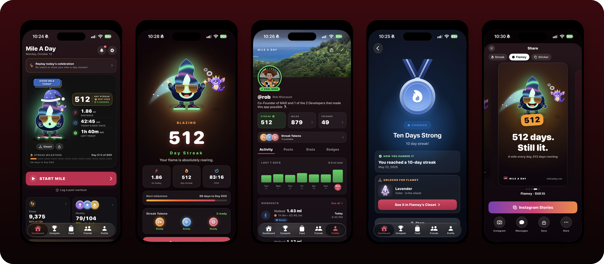
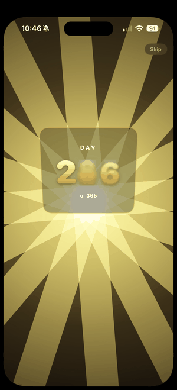
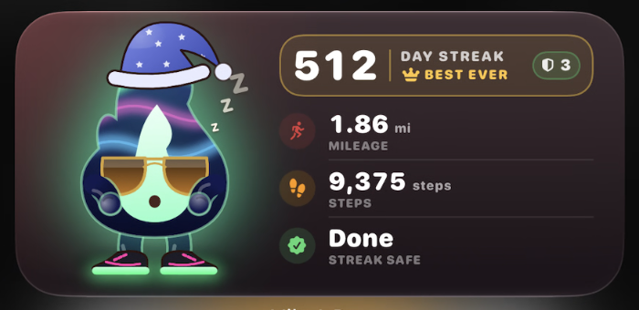
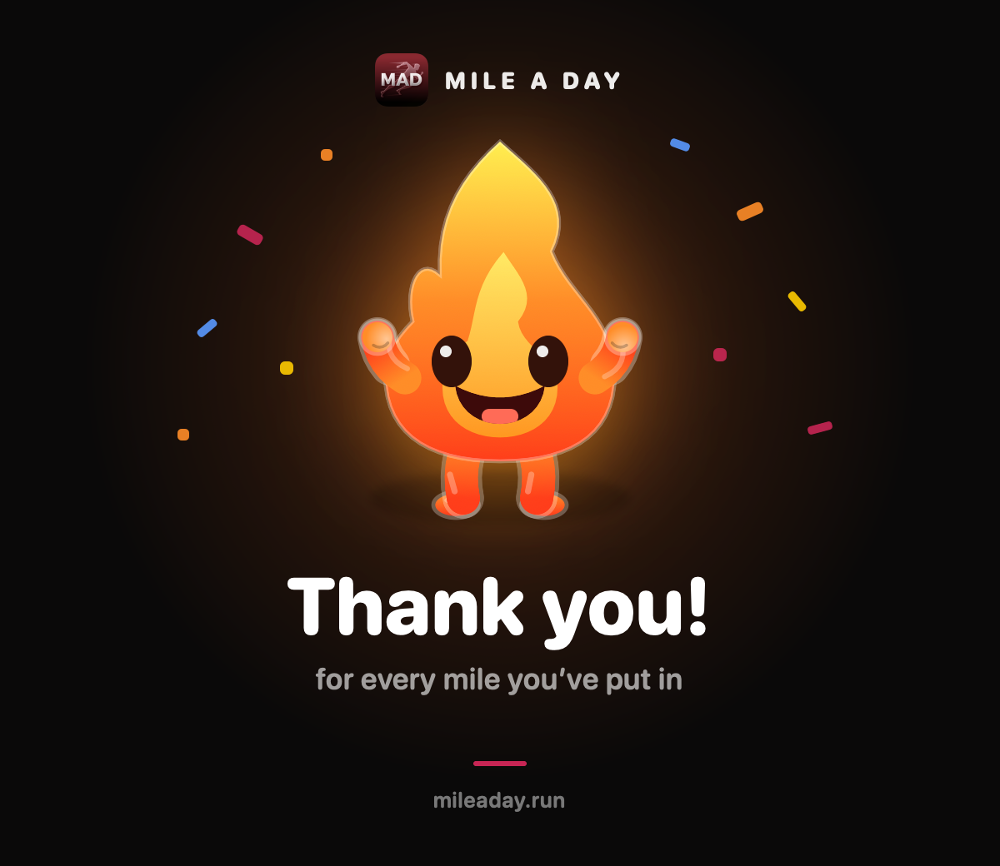

<p align="center">
  
</p>

<h1 align="center">Mile A Day</h1>

<p align="center">
  <b>One mile. Every day. No excuses.</b><br/>
  A free iOS app that turns a daily mile into a streak you will not let die.
</p>

<p align="center">
  <a href="https://apps.apple.com/app/mile-a-day/id6744917105"></a>
</p>

<p align="center">
  <a href="https://mileaday.run">mileaday.run</a> ·
  <a href="https://mileaday.shop">merch</a> ·
  built by <a href="https://github.com/robwizzie">@robwizzie</a> &amp; Dave
</p>

<p align="center">
  
</p>

## How it started

Two competitive friends made a bet over a Call of Duty skin: run a mile every day, first one to miss loses.
Nobody lost. The streak hit 368 days, and somewhere along the way it turned into an app so everyone else
could get hooked too.

## Meet Flamey 🔥

Flamey is your streak, in flame form. Hit your mile and he celebrates. Skip it and… well, he's a flame. Keep him lit.

<p align="center">
  
  &nbsp;&nbsp;&nbsp;
  
</p>

## What's inside

- **Automatic mile detection** from Apple Health and Apple Watch, plus a native watchOS app to start a mile from your wrist
- **Streaks, streak tokens and milestones** with a full-screen celebration for every mile and a legendary one for day 365
- **Compete with friends**: head-to-head races, ghost runs and leaderboards
- **Medals and badges** that unlock outfits and colors in Flamey's Closet
- **Share Studio** for Instagram-ready streak cards and stickers
- **Home and lock screen widgets** so your streak stares at you all day
- **Friends feed** with posts, reactions and nudges
- **A physical desk counter**: a 64×32 LED box ([`desk/`](desk)) that shows live community stats, running frozen CircuitPython on an Adafruit Matrix Portal

## Stack

| Area | Tech |
|---|---|
| iOS / watchOS / Widgets ([`app/`](app)) | SwiftUI, HealthKit, WidgetKit, WatchConnectivity |
| API ([`backend/`](backend)) | TypeScript, Express 5, PostgreSQL, Drizzle, JWT (`jose`) |
| Website ([`website/`](website)) | Next.js 16, React 19, Tailwind CSS 4 |
| Shop ([`shop/`](shop)) | Next.js 16, Shopify, WebGL garment previews |
| Desk counter ([`desk/`](desk)) | CircuitPython on Matrix Portal M4, MicroPython WebAssembly preview |

## Run it locally

```bash
# API
cd backend && npm install && npm run dev

# Website
cd website && npm install && npm run dev
```

The iOS app builds from `app/Mile A Day.xcodeproj` in Xcode (targets: Mile A Day, the Watch app and the widget extension).

<p align="center">
  
</p>
